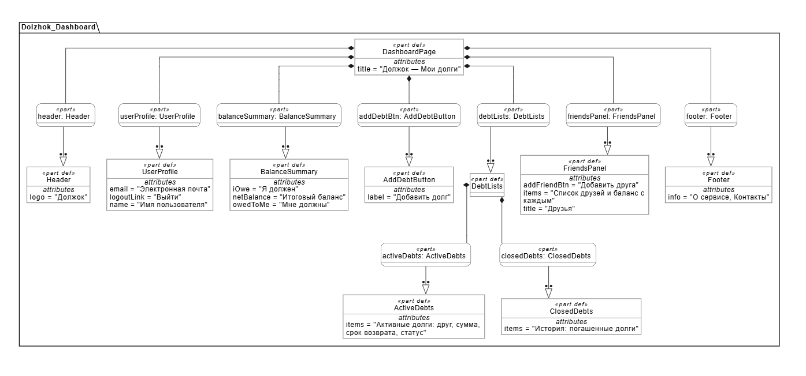
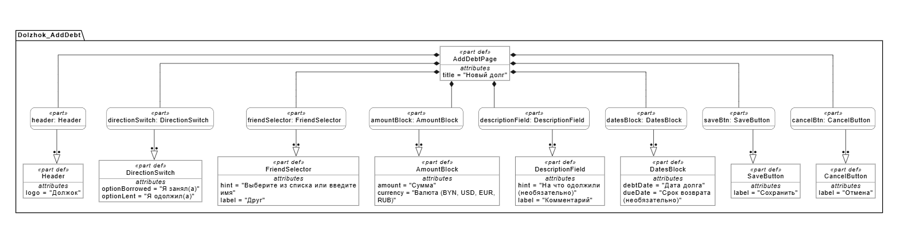

# Спецификация требований к программному обеспечению (SRS)

## «Должок» — веб-приложение для учёта долгов между друзьями

| Поле | Значение |
|------|----------|
| Версия | 0.2 (после раунда 2 переписки с Заказчиком) |
| Дата | 31.10.2026 |
| Автор (менеджер проекта) | Козак М.М. |
| Заказчик | Буцень Д.А. |
| Стандарты | IEEE 830-1998, ISO/IEC/IEEE 29148:2018 |

## Оглавление

* [1 Введение](#1-введение)
  * [1.1 Назначение](#11-назначение)
  * [1.2 Область применения](#12-область-применения)
  * [1.3 Глоссарий](#13-глоссарий)
  * [1.4 Ссылки](#14-ссылки)
* [2 Обзор продукта](#2-обзор-продукта)
  * [2.1 Бизнес-цели и проблема](#21-бизнес-цели-и-проблема)
  * [2.2 Контекст продукта](#22-контекст-продукта)
  * [2.3 Ключевые функции](#23-ключевые-функции)
  * [2.4 Пользователи](#24-пользователи)
  * [2.5 Ограничения и допущения](#25-ограничения-и-допущения)
* [3 Требования](#3-требования)
  * [3.1 Требования к внешним интерфейсам (REQ-UI)](#31-требования-к-внешним-интерфейсам-req-ui)
  * [3.2 Функциональные требования](#32-функциональные-требования)
  * [3.3 Требования к качеству (QoS)](#33-требования-к-качеству-qos)
  * [3.4 Соответствие требованиям (Compliance)](#34-соответствие-требованиям-compliance)
* [4 Верификация](#4-верификация)
* [Приложения](#приложения)
  * [Приложение А. Модели интерфейса (SysMLv2)](#приложение-а-модели-интерфейса-sysmlv2)
  * [Приложение Б. Журнал изменений](#приложение-б-журнал-изменений)
* [Связанные документы и файлы](#связанные-документы-и-файлы)

---

## Связанные документы и файлы

* [Исходный код модели Dashboard (SysML v2)](sysml/dashboard.sysml)
* [Исходный код модели Add Debt (SysML v2)](sysml/add_debt.sysml)
* [Мокап: Главная страница (PNG)](images/dashboard.png)
* [Мокап: Добавление долга (PNG)](images/add-debt.png)

---

## 1 Введение

### 1.1 Назначение

Документ описывает бизнес-требования и требования к программному обеспечению веб-приложения «Должок». Он предназначен для Заказчика (согласование требований), разработчиков (проектирование и реализация), тестировщиков (разработка тестов по матрице верификации).

### 1.2 Область применения

«Должок» — веб-приложение, в котором пользователи ведут учёт денежных долгов между собой и друзьями: кто, кому, сколько и когда должен вернуть.

**Входит в границы проекта (In scope):**
- регистрация и вход пользователей;
- список друзей;
- создание, просмотр, редактирование и закрытие долгов;
- частичное погашение долга;
- расчёт баланса с каждым другом и общего баланса;
- история операций;
- уведомления о приближающемся сроке возврата;
- поддержка нескольких валют (без пересчёта по курсу).

**Не входит в границы проекта (Out of scope):**
- проведение реальных денежных переводов и онлайн-оплата;
- нативные мобильные приложения;
- автоматическое разделение счёта по чекам (как в Splitwise). Групповой долг между тремя и более участниками входит в границы проекта (REQ-DEBT-008);
- пересчёт валют по курсу;
- юридическое оформление долговых расписок.

### 1.3 Глоссарий

| Термин | Определение |
|--------|-------------|
| Долг | Запись о денежной сумме, которую один пользователь (должник) обязан вернуть другому (кредитору) |
| Кредитор | Пользователь, который одолжил деньги |
| Должник | Пользователь, который занял деньги |
| Друг | Пользователь системы, с которым установлена связь (дружба принята обеими сторонами) |
| Баланс | Разность между суммой, которую должны пользователю, и суммой, которую должен он |
| Погашение | Платёж, уменьшающий остаток долга; может быть частичным или полным |
| Закрытый долг | Долг с нулевым остатком |
| Просроченный долг | Незакрытый долг, у которого срок возврата меньше текущей даты |
| SRS | Software Requirements Specification — спецификация требований к ПО |

### 1.4 Ссылки

- IEEE 830-1998 — Recommended Practice for Software Requirements Specifications.
- ISO/IEC/IEEE 29148:2018 — Requirements engineering.
- Графическая часть: `docs/images/dashboard.png`, `docs/images/add-debt.png`.
- Исходный код моделей SysMLv2: `docs/sysml/dashboard.sysml`, `docs/sysml/add_debt.sysml`.

---

## 2 Обзор продукта

### 2.1 Бизнес-цели и проблема

Люди часто одалживают друг другу небольшие суммы (обед, билеты, такси, подарок). Через время стороны забывают сумму и срок возврата, возникают неловкие разговоры и конфликты, записи ведутся в заметках и мессенджерах и теряются.

**Бизнес-цели:**

| ID | Цель |
|----|------|
| BG-01 | Сократить количество забытых и спорных долгов между друзьями |
| BG-02 | Дать обеим сторонам единую прозрачную запись о долге |
| BG-03 | Сделать напоминание о возврате деликатным (через систему, а не лично) |

### 2.2 Контекст продукта

Автономное веб-приложение. Внешние интеграции: сервис отправки электронной почты (подтверждение регистрации, уведомления). Платёжные системы не используются.

### 2.3 Ключевые функции

1. Регистрация и аутентификация.
2. Управление списком друзей (приглашение, принятие, удаление).
3. Создание записи о долге («Я одолжил(а)» / «Я занял(а)»).
4. Подтверждение долга второй стороной.
5. Частичное и полное погашение.
6. Баланс по каждому другу и общий.
7. История долгов и погашений.
8. Напоминания о сроке возврата.

### 2.4 Пользователи

| Роль | Описание | Технический уровень |
|------|----------|---------------------|
| Пользователь | Человек, ведущий учёт своих долгов; может выступать и кредитором, и должником | Базовый |
| Администратор | Сотрудник поддержки; блокирует учётные записи, рассматривает жалобы | Средний |

### 2.5 Ограничения и допущения

- Приложение реализуется на Java (Spring Boot); интерфейс — React; БД — PostgreSQL; развёртывание — Docker.
- Интерфейс адаптивный: корректно отображается на экране от 360 px по ширине.
- Язык интерфейса — русский.
- Пользователь самостоятельно вводит данные о долгах; система не проверяет реальность передачи денег.

---

## 3 Требования

Приоритет: **M** — обязательно (Must), **S** — желательно (Should), **C** — возможно (Could).

### 3.1 Требования к внешним интерфейсам (REQ-UI)

| ID | Требование | Приоритет |
|----|------------|-----------|
| REQ-UI-001 | Главная страница (рисунок `docs/images/dashboard.png`) содержит: шапку, профиль, сводку баланса, кнопку «Добавить долг», списки активных долгов и истории, панель друзей, подвал | M |
| REQ-UI-002 | Страница «Добавление долга» (рисунок `docs/images/add-debt.png`) содержит: переключатель направления, выбор друга, сумму и валюту, комментарий, даты, кнопки «Сохранить» и «Отмена» | M |
| REQ-UI-003 | Просроченные долги в списках визуально выделяются | S |
| REQ-UI-004 | Интерфейс корректно отображается на экранах шириной от 360 px | M |
| REQ-UI-005 | Сообщения об ошибках ввода показываются рядом с соответствующим полем | S |

### 3.2 Функциональные требования

#### Учётные записи (REQ-AUTH)

| ID | Требование | Приоритет |
|----|------------|-----------|
| REQ-AUTH-001 | Система должна позволять зарегистрироваться по адресу электронной почты, имени и паролю | M |
| REQ-AUTH-002 | Система должна отправлять письмо для подтверждения адреса электронной почты | S |
| REQ-AUTH-003 | Система должна позволять войти по почте и паролю и выйти из системы | M |
| REQ-AUTH-004 | Система должна позволять восстановить пароль по ссылке из письма | S |

#### Друзья (REQ-FR)

| ID | Требование | Приоритет |
|----|------------|-----------|
| REQ-FR-001 | Пользователь может отправить приглашение другому зарегистрированному пользователю по почте | M |
| REQ-FR-002 | Приглашённый пользователь может принять или отклонить приглашение | M |
| REQ-FR-003 | Пользователь может удалить друга из списка; история долгов с ним сохраняется | S |
| REQ-FR-004 | Пользователь может добавить «неподключённого» друга по имени (без аккаунта); такой долг ведётся только в записях пользователя | C |

#### Долги (REQ-DEBT)

| ID | Требование | Приоритет |
|----|------------|-----------|
| REQ-DEBT-001 | Пользователь может создать долг: направление (одолжил/занял), друг, сумма, валюта, дата, комментарий, срок возврата | M |
| REQ-DEBT-002 | Сумма долга должна быть положительным числом не более 2 знаков после запятой | M |
| REQ-DEBT-003 | Допустимые валюты: BYN, USD, EUR, RUB | M |
| REQ-DEBT-004 | Срок возврата, если указан, не может быть раньше даты долга | M |
| REQ-DEBT-005 | Вторая сторона должна подтвердить долг; до подтверждения долг имеет статус «Ожидает подтверждения» | S |
| REQ-DEBT-006 | Автор долга может редактировать неподтверждённый долг; подтверждённый — только по согласию второй стороны | S |
| REQ-DEBT-007 | Пользователь может удалить неподтверждённый долг | M |
| REQ-DEBT-008 | Групповой долг: запись долга на три и более участников (не более пяти) с делением суммы поровну; сумма долей совпадает с исходной до копейки | S |

#### Погашение (REQ-PAY)

| ID | Требование | Приоритет |
|----|------------|-----------|
| REQ-PAY-001 | Кредитор может зафиксировать погашение (частичное или полное) с указанием суммы и даты | M |
| REQ-PAY-002 | Сумма погашения не может превышать остаток долга | M |
| REQ-PAY-003 | При нулевом остатке долг автоматически переходит в статус «Закрыт» и отображается в истории | M |
| REQ-PAY-004 | Должник может отметить, что вернул деньги; запись вступает в силу после подтверждения кредитором | S |

#### Баланс и история (REQ-BAL)

| ID | Требование | Приоритет |
|----|------------|-----------|
| REQ-BAL-001 | Система показывает общий баланс («Мне должны» / «Я должен») отдельно по каждой валюте | M |
| REQ-BAL-002 | Система показывает баланс по каждому другу | M |
| REQ-BAL-003 | Система хранит и показывает историю долгов и погашений с фильтром по другу, статусу и периоду | S |
| REQ-BAL-004 | Система позволяет экспортировать историю в CSV | C |

#### Уведомления (REQ-NOT)

| ID | Требование | Приоритет |
|----|------------|-----------|
| REQ-NOT-001 | Система отправляет уведомление должнику за 3 дня до срока возврата и в день срока | S |
| REQ-NOT-002 | Система уведомляет вторую сторону о создании долга, погашении и закрытии | S |
| REQ-NOT-003 | Пользователь может отключить уведомления в настройках профиля | C |

#### Администрирование (REQ-ADM)

| ID | Требование | Приоритет |
|----|------------|-----------|
| REQ-ADM-001 | Администратор может заблокировать и разблокировать учётную запись | S |
| REQ-ADM-002 | Администратор не имеет доступа к паролям пользователей | M |

### 3.3 Требования к качеству (QoS)

#### Производительность (REQ-PERF)

| ID | Требование | Приоритет |
|----|------------|-----------|
| REQ-PERF-001 | Главная страница загружается не более чем за 2 с при 100 активных долгах у пользователя | M |
| REQ-PERF-002 | Система поддерживает не менее 500 одновременных пользователей | S |

#### Безопасность (REQ-SEC)

| ID | Требование | Приоритет |
|----|------------|-----------|
| REQ-SEC-001 | Пароли хранятся только в виде хэша с солью (bcrypt или аналог) | M |
| REQ-SEC-002 | Обмен данными между браузером и сервером защищён протоколом HTTPS | M |
| REQ-SEC-003 | Пользователь видит только свои долги и долги, где он является стороной | M |
| REQ-SEC-004 | Система защищена от SQL-инъекций и XSS | M |
| REQ-SEC-005 | После 5 неудачных попыток входа вход блокируется на 15 минут | S |

#### Надёжность и удобство (REQ-QUAL)

| ID | Требование | Приоритет |
|----|------------|-----------|
| REQ-QUAL-001 | Доступность сервиса не менее 99 % в месяц | S |
| REQ-QUAL-002 | Резервное копирование БД выполняется ежедневно | S |
| REQ-QUAL-003 | Новый пользователь может создать первый долг не более чем за 3 минуты без инструкции | S |
| REQ-QUAL-004 | Поддерживаются актуальные версии Chrome, Firefox, Edge, Safari | M |
| REQ-QUAL-005 | Журналирование: ошибки сервера, неудачные попытки входа и отправка уведомлений записываются в журнал без паролей и текстов комментариев | S |
| REQ-QUAL-006 | Система разворачивается в Docker одной командой (серверная часть, клиентская часть, PostgreSQL) | M |
| REQ-QUAL-007 | Создание долга, погашение и изменение остатка выполняются атомарно: остаток всегда равен сумме долга за вычетом погашений | M |

> Требования REQ-DEBT-008 и REQ-QUAL-005…007 добавлены в версии 0.2. REQ-DEBT-008 — по запросу Заказчика в раунде 2; REQ-QUAL-005…007 — предложены Исполнителем при проектировании (SDD, ADR-0001…0005) и требуют согласования с Заказчиком.

### 3.4 Соответствие требованиям (Compliance)

| ID | Требование | Приоритет |
|----|------------|-----------|
| REQ-CMP-001 | Система хранит минимум персональных данных (имя, почта) и позволяет пользователю удалить свой аккаунт | M |
| REQ-CMP-002 | Перед регистрацией пользователь принимает пользовательское соглашение и политику конфиденциальности | S |

---

## 4 Верификация

| ID требования | Метод | Критерий приёмки |
|---------------|-------|------------------|
| REQ-UI-001, REQ-UI-002 | Осмотр, демонстрация | Состав экранов соответствует мокапам |
| REQ-UI-004 | Тестирование | Нет горизонтальной прокрутки при ширине 360 px |
| REQ-AUTH-001, REQ-AUTH-003 | Тестирование | Регистрация и вход выполняются; неверный пароль отклоняется |
| REQ-DEBT-001..004 | Тестирование | Корректные данные сохраняются, некорректные отклоняются с сообщением |
| REQ-PAY-001..003 | Тестирование | Остаток уменьшается; при 0 долг закрывается; превышение остатка отклоняется |
| REQ-BAL-001, REQ-BAL-002 | Тестирование | Баланс совпадает с ручным расчётом на тестовом наборе |
| REQ-NOT-001 | Тестирование | Письмо приходит за 3 дня и в день срока |
| REQ-PERF-001 | Нагрузочное тестирование | Загрузка ≤ 2 с на тестовых данных |
| REQ-SEC-001, REQ-SEC-004 | Анализ, тестирование | В БД нет паролей в открытом виде; инъекции не проходят |
| REQ-SEC-002, REQ-SEC-003 | Тестирование | Доступ по HTTP закрыт; чужие долги недоступны по прямой ссылке |
| REQ-DEBT-008 | Тестирование | Сумма долей совпадает с исходной до копейки; более пяти участников отклоняется |
| REQ-QUAL-005 | Инспекция | В журнале есть записи указанных событий; пароли отсутствуют |
| REQ-QUAL-006 | Демонстрация | На чистой машине с Docker система запускается одной командой |
| REQ-QUAL-007 | Тестирование | При сбое во время сохранения остаток согласован с погашениями |

---

## Приложения

### Приложение А. Модели интерфейса (SysMLv2)

- `sysml/dashboard.sysml` — главная страница;
- `sysml/add_debt.sysml` — добавление долга.

### Приложение Б. Журнал изменений

| Версия | Дата | Описание | Автор |
|--------|------|----------|-------|
| 0.1 | 24.10.2026 | Первая версия по итогам беседы с Заказчиком | Козак М.М. |
| 0.2 | 31.10.2026 | Добавлены REQ-DEBT-008 (групповой долг, по запросу Заказчика), REQ-QUAL-005…007 (по предложению Исполнителя); групповой долг исключён из «не входит в границы» | Козак М.М. |